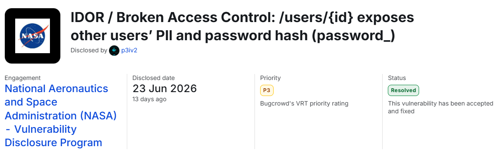

## Resumen

Una API de perfiles respondía a `GET /users/{id}` con los datos del usuario que pidieras, sin
comprobar que fuera el tuyo. Autenticado como la cuenta A, pedir `GET /users/{id_de_B}` devolvía
`200 OK` con el perfil de la cuenta B. Y la respuesta no solo traía PII (el `emailaddress`): incluía
`password_`, el **hash PBKDF2 de la contraseña**, un campo que jamás debería salir de la base de
datos.

Son dos fallos encadenados, y conviene separarlos:

```text title="Los dos fallos"
1. Broken Access Control (IDOR)
   → el servidor no comprueba que {id} sea el del usuario autenticado
2. Exposición excesiva de datos
   → el serializador devuelve emailaddress y password_ (hash) al cliente
```

El id es un entero correlativo, así que recorrer `/users/1`, `/users/2`… habría volcado el
directorio entero de usuarios. Solo accedí a datos de dos cuentas de prueba creadas por mí.



## Alcance

- **Activo**: un subdominio de staging de un portal educativo de la NASA, dentro del alcance de la
  VDP (el dominio del programa **y sus subdominios**). El host concreto va redactado.
- **Endpoint**: `GET /users/{id}`, con `GET /users/current` como ayuda para conocer el id propio.
- **Programa**: Vulnerability Disclosure Program de la NASA, gestionado en Bugcrowd. Es nombrable
  porque el propio programa aprobó y publicó la divulgación; el host, los identificadores y las
  credenciales siguen redactados.

## Cómo lo encontré

### `/users/current` es la pista

Muchas SPA resuelven "¿quién soy?" con un endpoint tipo `GET /users/current` que devuelve tu propio
perfil. Al verlo, la pregunta inmediata es: si `current` me da mi registro, ¿cómo lo identifica el
backend por dentro? Casi siempre por un id numérico. Y si ese id aparece en la respuesta, el
siguiente paso es obvio: pedir ese recurso por su id directo y, después, por el de otro.

```http title="Mi propio perfil"
GET /users/current HTTP/2
Host: app.example.com
Cookie: [redactado]
X-Csrf-Token: [redactado]
X-Requested-With: XMLHttpRequest
Accept: application/json
```

La respuesta traía mi `userid` (un entero), y resultó ser equivalente a `GET /users/{mi_id}`
estando autenticado. Dos caminos a la misma información: señal de que el control de acceso vive en
un solo sitio… o en ninguno.

> La petición original llevaba además una cabecera de clave de desarrollador del portal. La he
> quitado del writeup: no era necesaria para el fallo y es el tipo de secreto que no se republica.

### La prueba: dos cuentas mías

Para demostrar un IDOR sin tocar datos ajenos, el patrón limpio son **dos cuentas propias**. Creé
la cuenta A y la cuenta B, saqué el id de cada una con `/users/current`, y después, autenticado
**solo como A**, pedí el recurso de B.

| Cuenta | userid (placeholder) | Rol en la prueba |
|---|---|---|
| A | `104233` | La sesión autenticada |
| B | `104518` | La víctima (también mía) |

## Prueba de concepto

**1.** Inicia sesión como la cuenta A y confirma su id:

```http
GET /users/current HTTP/2
Host: app.example.com
Cookie: [redactado — sesión de A]
Accept: application/json
```

Devuelve `200 OK` con `"userid": 104233`.

**2.** Sin cambiar de sesión (sigues siendo A), pide el perfil de B por su id:

```http
GET /users/104518 HTTP/2
Host: app.example.com
Cookie: [redactado — sesión de A]
Accept: application/json
```

**3.** Resultado: `200 OK` con el perfil completo de B, incluido el hash de su contraseña:

```json title="Respuesta (redactada)"
{
  "userid": 104518,
  "screenname": "[redactado]",
  "emailaddress": "victima@example.com",
  "password_": "{PBKDF2WITHHMACSHA1}[hash redactado]="
}
```

**Resultado esperado**: `403 Forbidden` al pedir el registro de otro usuario, y `password_` no
debería aparecer **en ninguna** respuesta.

Comprobado: `GET /users/104233` como A devuelve A (correcto); `GET /users/104518` como A devuelve B
(no debería).

## Impacto

- **Acceso al perfil de cualquier usuario**: con una cuenta válida —y registrarse era abierto— se
  leía el registro de cualquier otro cambiando un número.
- **Enumeración masiva**: al ser el id un entero correlativo, recorrer el rango vuelca el directorio
  entero. PII de todos los usuarios: emails para phishing dirigido y enumeración de cuentas.
- **Hashes de contraseña**: `password_` exponía el hash PBKDF2. Aunque PBKDF2 es lento de crackear,
  entregar hashes al cliente es grave: habilita el crackeo offline de las contraseñas débiles y, si
  la respuesta se filtra por otra vía (un XSS, un log, una caché mal configurada), el daño se
  multiplica. Un hash de contraseña es un secreto del servidor; que viaje al navegador ya es la
  brecha.

### Por qué es Medium: el CVSS métrica a métrica

| Métrica | Valor | Por qué |
|---|---|---|
| Attack Vector | Network | Una petición HTTP desde Internet |
| Attack Complexity | Low | Cambiar un número, sin condiciones |
| Privileges Required | Low | Hace falta una cuenta (el registro era abierto) |
| User Interaction | None | La víctima no hace nada |
| Scope | Unchanged | El impacto se queda en la propia aplicación |
| Confidentiality | High | PII y hashes de contraseña de todos los usuarios |
| Integrity | None | Solo lectura |
| Availability | None | El servicio sigue funcionando |

`CVSS:3.1/AV:N/AC:L/PR:L/UI:N/S:U/C:H/I:N/A:N` da **6.5 (Medium)**, que es el **P3** de la taxonomía
de Bugcrowd con el que el programa lo clasificó.

## Corrección

La causa raíz es que el endpoint confía en el `{id}` de la URL sin comprobar que pertenece a quien
pregunta. Es el patrón clásico del IDOR: **autenticación sin autorización**. Saber quién llama
(sesión válida) no es lo mismo que comprobar que tiene permiso sobre ese recurso.

1. **Autorización por propietario**: en `GET /users/{id}`, comparar `{id}` con el id de la sesión y
   devolver `403` si no coinciden (salvo un rol privilegiado explícito).
2. **Nunca el hash**: quitar `password_` de todas las respuestas. Mejor con una **lista blanca** de
   campos seguros en el serializador que con una lista negra: lo que no está en la lista, no sale.
3. **IDs no adivinables** (defensa en profundidad): identificadores aleatorios (UUID) en lugar de
   enteros correlativos encarecen la enumeración, aunque el control que de verdad importa es la
   autorización.

En código, el arreglo es una comprobación de propiedad antes de responder:

```js title="users.controller.js" del={2} ins={3-5}
app.get('/users/:id', requireAuth, (req, res) => {
  const user = db.users.find(req.params.id);          // devuelve el perfil pidas lo que pidas
  if (String(req.params.id) !== String(req.user.id))  // ¿es tu propio registro?
    return res.sendStatus(403);
  const user = db.users.find(req.user.id);
  res.json(pick(user, ['userid', 'screenname', 'emailaddress'])); // lista blanca: sin password_
});
```

**Cómo detectarlo antes de producción**: un test de autorización que, con la sesión de A, pida el
recurso de B y espere un `403`; y un test de contrato que falle si cualquier respuesta de la API
contiene un campo de la lista negra (`password`, `password_`, `hash`, `token`). Los dos corren en CI
y atrapan la regresión en cuanto alguien añade un endpoint nuevo.

## Lo que me llevo

- Un endpoint `/me` o `/users/current` casi siempre esconde detrás un `/users/{id}`: el primero
  dice que el backend te identifica por un id, el segundo deja probar si respeta ese límite.
- Para demostrar un IDOR, dos cuentas propias. Nunca hace falta tocar datos de usuarios reales para
  probar el fallo ni medir el impacto.
- Un hash de contraseña en una respuesta de API es un hallazgo en sí mismo, aunque el algoritmo sea
  fuerte: el secreto no debería salir del servidor.
- La VDP de la NASA no paga en metálico, pero una carta de reconocimiento firmada vale su peso para
  el portfolio. Pregunté por ella en cuanto el fallo se marcó como resuelto y me la emitieron junto
  con la aprobación de la divulgación.
